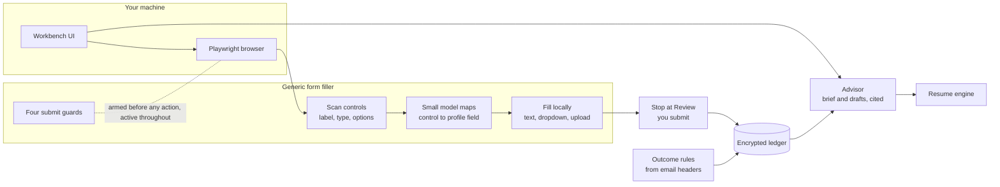

# Usher

**The job-application agent you can verify.**

[](LICENSE)


*Ten hidden submit traps: nine stopped on the spot, the tenth, fired by the page itself, caught just after it leaves the browser.*

Usher builds your resume PDF, drafts the written answers from your real experience, fills the application, stops short of Submit, and hands it to you. You read every application before it goes out.

Three things are enforced in code, not promised:

1. **It can't press Submit.**
2. **The models don't get your personal details.**
3. **It can't cite experience you don't have.**

Applicant tracking systems are starting to filter and flag automated applications. Usher is built for fewer, tailored applications that you have actually reviewed, not for volume.

I'm building it for my own new-grad job search.

---

## Try the guards

```
git clone https://github.com/Ivanyifan/usher && cd usher/submit-guard
python -m pip install -e ".[test]" && python -m playwright install chromium
python -m pytest -q              # the guard tests and the ten-trap challenge
python -m challenge.run_demo     # records the guarded run to demo/demo.webm
```

A real run stops at the first block; the demo keeps going so all ten traps can be shown. Its captions come from the demo script, not from the guards. What the guards don't cover is listed under [Known gaps](submit-guard/README.md#known-gaps).

## What is enforced

1. **It can't press Submit.** Four independent guards block the submit paths we have mapped, and a self-check refuses to start unless every guard is proven live. The guard's test suite, the ten-trap demo page and its list of known gaps will be the public proof.
2. **The models don't get your personal details.** The form-filling model sees only the question, the control type and the options. Your name, email, phone and links are never sent to a model. The only profile values the form-filling model ever sees are your city, school and major, used to match long dropdown lists, and the program clicks only when two different models pick the same option. The drafting advisor sees your experience descriptions with references, links, emails and phone numbers replaced by placeholders.
3. **It can't cite experience you don't have.** Every body paragraph the advisor drafts must cite an entry in your evidence base. A number that isn't in the cited evidence, or a name that appears in neither your evidence nor the job posting, is flagged, and the draft can't be exported until it is fixed.

## How it works

**Filling a form.** Usher drives Chromium through Playwright. It reads the application page as a list of controls: label, type, options. A small model answers one question per control: which profile field does this ask for, or is it something only you should answer? The model returns a field name, `none` or `sensitive`, never a value and never an option position. The program then fills the real value locally. The one exception is the city, school and major dropdowns, where your value and the options go to two different models and Usher clicks only when both pick the same option.

**Sensitive questions stay with you.** Sponsorship, gender, ethnicity, veteran status, disability and consent questions are never filled automatically. Work authorization is filled only from the answer you recorded yourself, and only when the question names the country. Pronouns come only from the value you recorded.

**Drafting.** For each posting, an advisor reads your evidence base and the posting and writes a brief: fit, where you match, a resume plan, and drafts of cover letters or "why us" answers. Each paragraph cites the evidence it rests on, and nothing is used until you approve it.

**Learning from outcomes.** Every application goes into an encrypted local ledger. Interview, rejection and offer emails are recognized by fixed rules from the message headers; no email content is sent to a model. Long silence counts as "no response".

**Local-first.** Data lives in a local SQLite database, encrypted with the operating system's key store. The schema is ready for more than one user; a multi-user version is planned.

## Architecture



Details: [docs/architecture.md](docs/architecture.md). Design choices and trade-offs: [docs/design-notes.md](docs/design-notes.md).

## Status

| Part | State |
|---|---|
| One large enterprise applicant-tracking system, filled to the review page | done |
| Two more systems, through the generic form filler | in trial |
| A third system | later |
| Resume engine, advisor brief and drafts, ledger, outcome rules | done |
| Real mailbox connection | next |
| Multi-user version | planned |

## About this repository

Not affiliated with any recruiting-system vendor.

This is the public showcase for Usher. The main codebase is private. If you'd like to see more, I'm happy to walk through the code on a call.

Contact: open an issue or reach me through my GitHub profile.

License: MIT (applies to any code in this repository).
